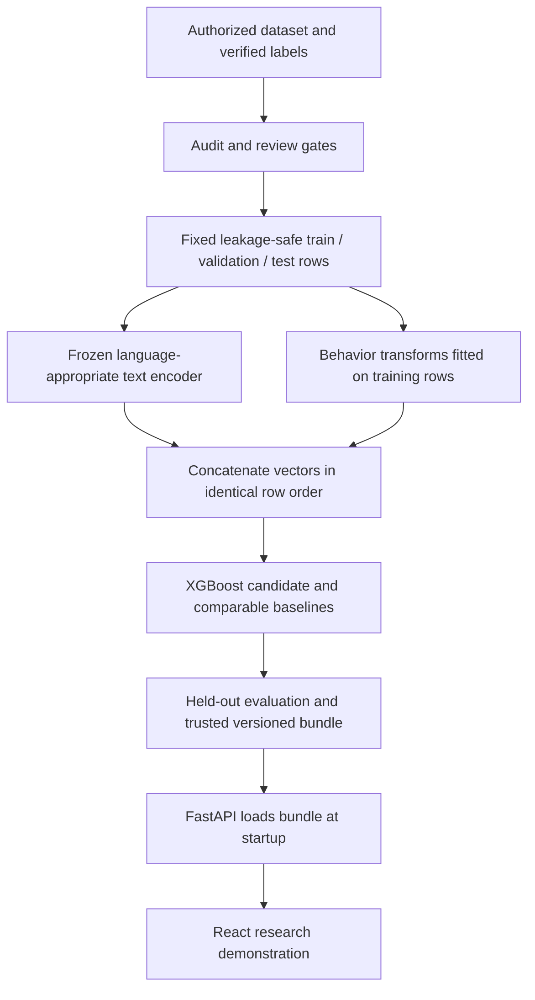

# Architecture — proposed, pending approval

Source: guide pp. 3–9. No trained or deployed system exists.

ADR-001, pending: Transformer + numeric behavioral fusion + XGBoost is the proposed
starting architecture. It combines modeling techniques and modalities, but the
supervisor may require a different hybrid definition. Do not finalize model code first.

ADR-002, provisional implementation choice: no database. Local authorized CSV data
and restricted aggregate reports suffice for auditing. Parquet support can be added
after the actual format is known. No collection pipeline or external account access.

One future shared preprocessing/prediction module will serve evaluation and API
inference. Preserve exact encoder ID/revision, tokenizer/truncation policy, embedding
normalization/dimension, numeric feature order, fitted imputer/scaler, class mapping,
dataset hash, split manifest, seed, package versions and model version.

Choose group splits for repeated users; future prediction also needs chronological
boundaries, feature cutoff checks and possibly a purge gap. Define this from the unit
of prediction and target horizon. Never fit transforms or resample outside training.
Check row identities as well as matrix dimensions before fusion.

Evaluate text-only, behavior-only, hybrid and a simpler classifier on the same
eligible rows and split. Tune on training/validation only. Freeze selection before
final held-out evaluation; record every test exposure.

API plan: GET /health reports readiness; GET /model-info exposes safe version and
approved input schema; POST /predict validates inputs and calls shared inference.
Absent/incompatible artifacts must produce unavailable status, never dummy predictions.
Exact request fields and ranges depend on the approved data dictionary. Local demo
binds to loopback; deployment requires authentication, HTTPS, rate limits and restricted
CORS. No raw text logging or persistence by default.

React plan: render approved features, text input, validation, loading/errors, research
class, supported probabilities and version. Read API base URL from environment.
Explanation integration waits for a teammate contract; no fabricated explanation.
